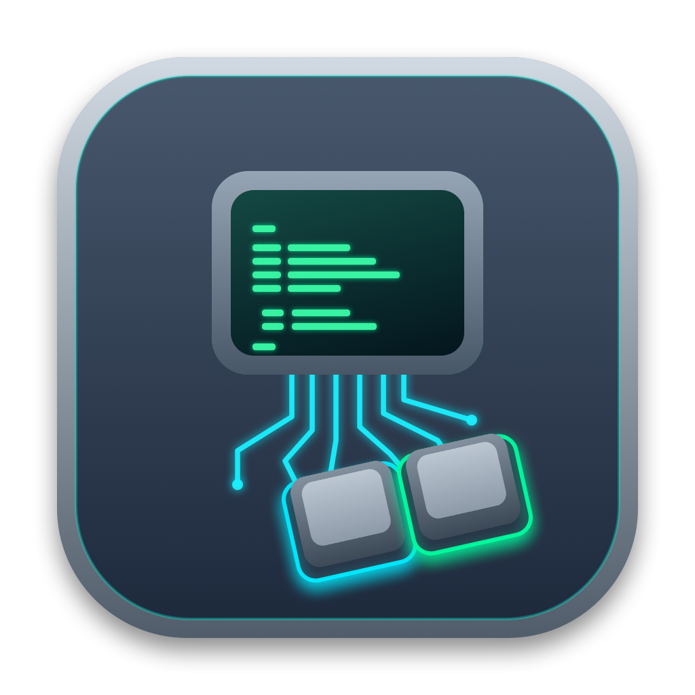

# MiniKVM — macOS 原生 USB KVM 控制台 (USB Video + CH340/CH9329)



**MiniKVM** 是一款专为便携式 USB KVM 采集控制线（**USB Video 视频采集卡 + 沁恒 CH340 USB 转串口 + CH9329 串口转标准 USB HID 键鼠芯片**）打造的 **macOS 原生桌面应用**（基于 Swift + AppKit + AVFoundation + CoreVideo + POSIX `termios` 构建，零第三方依赖）。

---

## ✨ 功能特性

- **🖥️ 低延迟原生视频画面 (`AVFoundation`)**
  - 自动发现并优先选择 `USB Video` 等外置采集卡，支持切换视频源与设备热插拔刷新。
  - 原生硬件加速预览层（`AVCaptureVideoPreviewLayer`），保持对端画面长宽比自适应缩放。
- **⌨️ 实时全键盘捕获与无冲转发 (`CH9329 HID 协议`)**
  - 自动探测串口（`/dev/cu.usbserial-*`）与波特率（`9600` / `115200` bps），支持双向状态查询（固件版本、对端 USB 连接状态、`CapsLock` 状态）及单向 TX 线材兼容。
  - 支持最多 6 键同时按下无冲（6KRO）与修饰键（`Ctrl`、`Shift`、`Alt/Option`、`Win/Command`）实时同步。
  - 支持 **`Cmd ➔ Ctrl` 映射开关**，在 Mac 上按 `Cmd+C` / `Cmd+V` 可直接向对端发送 `Ctrl+C` / `Ctrl+V`。
- **🚀 绕过 macOS 系统拦截的 `F1` ~ `F12` 与 TTY 切换方案**
  - 针对 macOS 系统底层拦截 `Option + F1/F2`（显示器设置）与 `F10/F11/F12`（音量/显示桌面）的问题，内置 **`Fn + 顶部数字键 (1~0, -, =)` 映射 `F1~F12`**。
  - 工具栏提供 **持续锁定的 `Ctrl` / `Alt` / `Shift` 复选框**、**`F1-F12 / 组合键 ▾` 下拉菜单**（含 Linux `TTY1`~`TTY7`）以及常用一键按钮（`Alt+F1`、`Alt+F2`、`Ctrl+Alt+F6`、`F2`、`F10`、`F12`、`Ctrl+Alt+Del`、`Esc`、`释放按键`）。
- **🖱️ 鼠标绝对坐标同步**
  - 勾选 **“鼠标同步”** 后，在视频画面内移动、左/右键点击、拖拽与滚轮操作会自动按画面实际显示比例（`0 ~ 4095`）转换为 CH9329 绝对鼠标指令发送给对端。
- **⏺ 视频与键鼠事件 OSD 同步录制**
  - 点击 **`⏺ 录制视频`** 即可将画面实时编码保存至系统“影片”目录：`~/Movies/MiniKVM-yyyy-MM-dd-HH-mm-ss.mp4`，并实时显示已录制时长。
  - 录制过程中敲击的按键、组合键与鼠标点击位置会以 **OSD 字幕条与光标圆环** 形式实时合成到视频画面右下角，并同步生成同名时间轴日志文件 `MiniKVM-yyyy-MM-dd-HH-mm-ss-events.log`。
- **📋 批量文本粘贴与命令行脚本**
  - 顶部内置文本粘贴发送框（可选自动追加回车），方便一键输入复杂密码或长命令。
  - 附带独立零依赖 Python 命令行脚本 [`send_keys.py`](send_keys.py)，支持在终端或自动化脚本中直接发送按键。

---

## ⌨️ 常用按键与组合键速查表

当鼠标点击黑色视频画面开启捕获（四周亮起绿框）后，可使用以下方式发送特殊组合键：

| 目标对端信号 | 物理键盘按法（焦点在视频画面内） | 工具栏操作方式 | CH9329 HID 键值 |
| :--- | :--- | :--- | :--- |
| **`F1` ~ `F9`** | **`Fn + 1` ~ `Fn + 9`** | 在 `F1-F12 / 组合键 ▾` 菜单中选择 | `Key: 0x3A ~ 0x42` |
| **`F10`** | **`Fn + 0`** | 点击工具栏 **`F10`** | `Key: 0x43` |
| **`F11`** | **`Fn + -`** | 在下拉菜单中选择 **`F11`** | `Key: 0x44` |
| **`F12`** | **`Fn + =`** | 点击工具栏 **`F12`** | `Key: 0x45` |
| **`Alt + F1`** | **`Fn + Option + 1`** | 点击工具栏 **`Alt+F1`** | `Mod: 0x04, Key: 0x3A` |
| **`Alt + F2`** | **`Fn + Option + 2`** | 点击工具栏 **`Alt+F2`** | `Mod: 0x04, Key: 0x3B` |
| **`Ctrl + Alt + F6`** | **`Fn + Control + Option + 6`** | 点击工具栏 **`Ctrl+Alt+F6`** | `Mod: 0x05, Key: 0x3F` |
| **释放键盘焦点** | **`Control + Option + Esc`** | 点击顶部 **`🟢 键盘捕获`** 按钮 | 自动发送全键释放包 |

---

## 🛠️ 编译与运行

### 1. 直接运行应用

```bash
open ./MiniKVM.app
```

> 首次启动时，macOS 会提示需要访问“摄像头”权限，请点击允许以加载 `USB Video` 采集画面。

### 2. 从源码重新编译打包

项目仅依赖 macOS 原生 Xcode Command Line Tools (`swiftc`)，执行 `./build.sh` 即可一键生成图标、编译二进制并完成签名打包：

```bash
chmod +x build.sh
./build.sh
```

### 3. 使用 Python 命令行工具发送文本

```bash
# 自动探测波特率并向 /dev/cu.usbserial-1410 发送默认测试文本
python3 send_keys.py

# 发送指定字符串并在末尾按下回车
python3 send_keys.py "root" -e

# 手动指定串口与波特率
python3 send_keys.py -p /dev/cu.usbserial-1410 -b 9600 "1234ABCD!@#$TEST"
```

---

## 📂 项目目录结构

```text
.
├── MiniKVM.swift        # macOS 原生应用主源码 (AppKit + AVFoundation + CH9329 + OSD 录像)
├── generate_icns.swift  # 应用图标生成器 (CoreGraphics 渲染多分辨率 AppIcon.icns)
├── build.sh             # 一键编译、图标打包与代码签名脚本
├── send_keys.py         # 零依赖 Python 命令行按键发送工具
├── AppIcon.png          # 1024x1024 应用图标预览图
└── MiniKVM.app/         # 编译打包好的 macOS 原生应用包
```
